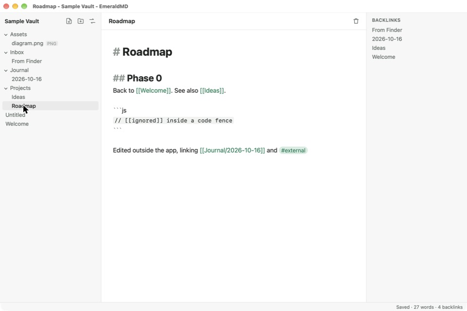

# EmeraldMD

An open-source, local-first Markdown knowledge base. It opens existing Obsidian
vaults as they are and aims to run Obsidian community plugins and themes
unchanged. Vaults can live on your disk or on your own self-hosted server.

Targets: Linux, macOS, Windows, iOS/iPadOS and Android, built on
**Tauri v2 with a Rust core** and a web UI. See
[docs/ARCHITECTURE.md](docs/ARCHITECTURE.md) for the design, the plugin
compatibility strategy and the roadmap.



> EmeraldMD is an independent project and is not affiliated with Obsidian.
> "Compatible with Obsidian plugins" describes interoperability only.

## Status

Phase 0 (foundations), implemented on desktop (built and run on macOS so far):

- Open any folder as a vault (existing Obsidian vaults included). Hidden
  folders such as `.obsidian` and `.trash` are left alone.
- File tree, new note/folder, rename via the title field, move to `.trash`
  (nothing is ever deleted permanently).
- CodeMirror 6 Markdown editor with 2-second autosave, and Cmd/Ctrl-click to
  follow `[[wikilinks]]`. Following a link to a missing note creates it.
- Rust index of frontmatter, headings, links, embeds, tags and block ids, with
  link resolution and a backlinks pane.
- Live reload of changes made outside the app (another editor, sync tools,
  Obsidian itself).

Self-hosting (phase 3, first slice):

- `emeraldmd-server` serves vault folders over HTTP, with a WebSocket that
  pushes every change, including edits made directly on the server's disk.
  Argon2-hashed bearer tokens, a Docker image, and a guide for running it
  behind HTTPS: [docs/self-hosting.md](docs/self-hosting.md).
- The desktop app connects to it with **Connect to server** (URL and token).
  You browse, edit and create notes on the server, and changes from other
  devices show up live. Tokens are kept in the OS keychain.

Not yet: plugins, themes and snippets, live preview and reading view, search,
graph, offline sync with a self-hosted server, mobile builds. See the roadmap.

## Repository layout

| Path | What |
|---|---|
| `crates/emerald-core` | Rust: vault I/O, Markdown metadata parser, link index, `VaultSession` |
| `crates/emerald-server` | Rust: `emeraldmd-server`, the self-hosted server (`Dockerfile` at the root) |
| `packages/core` | TypeScript mirror of the vault and metadata cache, with the plugin API's shapes, and `RemoteBackend` for server vaults |
| `packages/editor` | CodeMirror 6 editor |
| `apps/desktop` | Tauri app: `src-tauri/` (Rust shell) and `src/` (UI) |
| `fixtures/` | Test cases shared by the Rust and TypeScript test suites |

## Development

Requirements: Node.js 22+, Rust (stable) and the
[Tauri prerequisites](https://v2.tauri.app/start/prerequisites/) for your OS.

```bash
npm install
```

```bash
npm run dev
```

```bash
npm test
```

To try a self-hosted vault locally, create a token and start the server
(see [docs/self-hosting.md](docs/self-hosting.md) for the config file):

```bash
cargo run -p emerald-server -- token new
```

```bash
cargo run -p emerald-server -- --config emeraldmd-server.toml
```

`npm test` runs Vitest and `cargo test`. `npm run typecheck` type-checks the
TypeScript. `npm run build` produces installable bundles in
`target/release/bundle/`.

On macOS with Homebrew's `rustup`, which is keg-only, put it on your `PATH`
first, for example by adding this line to `~/.zshrc`:

```bash
export PATH="/opt/homebrew/opt/rustup/bin:$PATH"
```

## Contributing

Read [CONTRIBUTING.md](CONTRIBUTING.md) first, especially the clean-room rules.

## License

[MIT](LICENSE)
